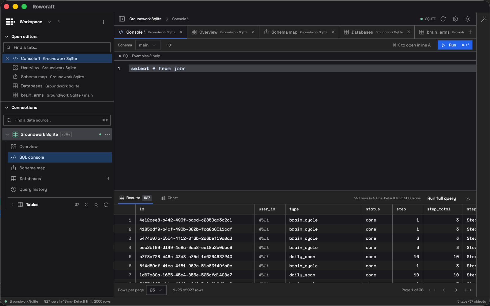

# Rowcraft

An open-source database workbench with a Rust engine, a Tauri desktop app, and a command-line interface.

Browse schemas, write queries, inspect results, and manage connections from one workspace. Rowcraft brings SQL databases, document stores, key-value stores, and HTTP APIs into a shared interface, with consoles adapted to each query language.

[Get started](#get-started) · [Database support](#database-support) · [Build installers](#build-installers) · [Contributing](#contributing) · [Documentation](#documentation)



## Project status

Rowcraft is in early development. Connector coverage and validation vary by database; a driver appearing in the catalog does not mean every vendor, version, or feature has been tested. See the [support table](#database-support) and [connector boundaries](docs/database-consoles.md) before choosing a connection.

The project is independently developed and is not affiliated with JetBrains. Feature parity with DataGrip is not claimed. Performance comparisons require measurements against equivalent workloads.

## Features

- **Database explorer:** browse schemas, tables, views, columns, indexes, keys, and routines where the connector exposes them.
- **Query consoles:** SQL, MongoDB shell statements, Redis commands, CQL, PartiQL, SQL++, Cypher, and GraphQL, depending on the selected source.
- **Results workspace:** virtualized tables, JSON views, and charts for supported result shapes.
- **Persistent sessions:** switch between tabs without reconnecting or rerunning existing results. Consoles for the same source share its backend session and transaction state.
- **Connection management:** saved sources, connection testing, schema filters, custom drivers, and SSH tunnels.
- **SQLite file import:** open a local database or import a validated copy through the desktop UI.
- **Optional AI assistance:** query help through a configurable gateway, with optional local 9router integration.
- **Headless CLI:** run queries, export results, inspect catalogs, and manage sources without starting the desktop app.

The desktop uses the system webview. Database operations run in Rust, and production frontend assets are embedded in the application.

## Get started

### Prerequisites

For desktop development, install:

| Tool | Requirement |
| --- | --- |
| Rust | Stable toolchain; see [rust-toolchain.toml](rust-toolchain.toml) |
| Node.js | 24, matching the installer workflow |
| pnpm | 11.6.0, pinned in the desktop package |
| Native build tools | Xcode command-line tools on macOS; Visual Studio C++ Build Tools and Windows SDK on Windows; WebKitGTK 4.1 and development libraries on Linux |

Follow the [Tauri platform prerequisites](https://v2.tauri.app/start/prerequisites/) for the complete native dependency list. Java 11+ and vendor driver JARs are needed only for JDBC connections. SQLite is bundled and needs no separate server.

### Run the desktop app

From the repository root:

```sh
pnpm --dir apps/dg-desktop install --frozen-lockfile
pnpm --dir apps/dg-desktop tauri dev
```

On macOS and Linux, the Makefile provides the same workflow:

```sh
make gui-install
make run-gui
```

In the app:

1. Select **+ Add** and choose a database type.
2. Enter connection details and use **Test Connection**.
3. Save the source and select it in the explorer to connect.
4. Open a console and run a statement with **Cmd+Enter** on macOS or **Ctrl+Enter** elsewhere. A selected statement runs instead of the whole editor.

The default result limit is 1,000 rows. Use explicit server-side limits when exploring large datasets.

### Try SQLite without a server

With the `sqlite3` command installed, this creates a small disposable database and opens the desktop app with a separate configuration:

```sh
make desktop-demo
```

Demo data lives under `.dev/`. Running the command again recreates its database and configuration.

To use your own file, choose **+ Add → SQLite → Upload SQLite file…**. Rowcraft imports a copy into `<config-dir>/sqlite-imports/`; the upload limit is 256 MB. For larger files, enter the local database path directly.

### Preview the interface in a browser

```sh
make web
```

Open `http://localhost:1420`. This development preview uses mock data. Real connections, SQLite imports, and database queries require the desktop app.

## Command-line interface

The CLI binary is named `dg`. To build it:

```sh
cargo build --release -p dg-cli
```

The executable is `target/release/dg` on macOS/Linux and `target/release/dg.exe` on Windows. The examples below use `cargo run` so no PATH setup is required.

### Query a local SQLite database

```sh
cargo run -p dg-cli -- ds add local-sqlite --dialect sqlite --database /absolute/path/to/example.sqlite
cargo run -p dg-cli -- ds test local-sqlite
cargo run -p dg-cli -- query -d local-sqlite "SELECT sqlite_version();"
cargo run -p dg-cli -- introspect -d local-sqlite -f json
```

### Connect to PostgreSQL

Set `APP_PW` in your shell to the database password, then save a reference to that environment variable:

```sh
cargo run -p dg-cli -- ds add local-pg \
  --host localhost --port 5432 --database app --user me --password-env APP_PW

cargo run -p dg-cli -- ds test local-pg
cargo run -p dg-cli -- query -d local-pg -f csv "SELECT * FROM people LIMIT 1000;" > people.csv
cargo run -p dg-cli -- introspect -d local-pg -s public
```

The desktop app reads the same saved sources. When a source uses an environment-variable password, launch the desktop app from a shell where that variable is set.

### Discover commands and drivers

```sh
cargo run -p dg-cli -- --help
cargo run -p dg-cli -- dialects
cargo run -p dg-cli -- drivers
cargo run -p dg-cli -- ds --help
cargo run -p dg-cli -- query --help
```

CLI exit codes are `0` for success, `1` for statement errors, `2` for connection/authentication errors, and `3` for usage/configuration errors.

## Database support

Rowcraft uses Rust drivers, HTTP connectors, compatible wire protocols, and a JDBC bridge. The table records the validation described in this repository; it is not a guarantee for every deployment.

| Database or family | Connection path | Validation / limitations |
| --- | --- | --- |
| PostgreSQL, YugabyteDB | PostgreSQL driver | Live-server verification recorded |
| SQLite | Bundled SQLite | Local-file round trips verified |
| MySQL, MariaDB; Aurora MySQL, TiDB, SingleStore via MySQL | MySQL driver | MySQL 9.7 verified; other variants need live validation |
| Redshift, Greenplum, CockroachDB | PostgreSQL protocol | Greenplum path tested against PostgreSQL 14; vendor validation remains |
| Vertica | PostgreSQL protocol | No live verification; authentication support is limited |
| H2 | PostgreSQL server mode | Requires H2 PG server mode; no live verification |
| MongoDB, DocumentDB | MongoDB driver | MongoDB 7 verified; supported shell statements only |
| Redis | Redis driver | Live-server verification recorded |
| Cassandra | Scylla/Cassandra driver | Cassandra 5 verified |
| DynamoDB | PartiQL over HTTP | DynamoDB Local verified |
| Trino, Presto | HTTP statement protocol | Trino verified; Presto needs live validation |
| ClickHouse | HTTP | Request-format tests with a fake server |
| SQL Server, Azure SQL, Synapse | TDS driver | SQL authentication; unit tests only |
| Snowflake | REST API | Password authentication; unit tests only |
| Couchbase | Query service HTTP API | Unit tests only |
| Neo4j, GraphQL APIs | HTTP | Unit tests; live-server verification pending |
| Oracle, Db2, Derby, HSQLDB, Exasol, Hive, Spark, BigQuery, Athena, DuckDB, Databricks, Firebird, Informix, HANA, Teradata, and other catalog entries | JDBC | Java 11+, vendor JARs, and a reachable database required; coverage varies |

For native query languages, endpoint configuration, introspection behavior, and unsupported features, read [database consoles and support boundaries](docs/database-consoles.md). Connection options that are implemented versus only stored are documented in [data source options](docs/datagrip-datasource-options.md).

### JDBC and custom drivers

Create a driver under **+ Add → Drivers → + Custom driver**. A JDBC driver needs its JARs, a driver class when auto-discovery is unavailable, and a URL template. Templates support `{host}`, `{port}`, `{database}`, and `{user}`.

For built-in JDBC entries, place JARs under `<config-dir>/jdbc/<driver-id>/` or configure `jdbc.jars`, `jdbc.class`, and `jdbc.url_template` in Advanced. Vendor JARs are not bundled or automatically downloaded. Existing DataGrip driver downloads can be reused when detected on macOS.

Use `DGLITE_JAVA` to select a Java executable or set `JAVA_HOME`. See [JDBC setup](docs/jdbc-drivers.md) for details.

## Configuration and credentials

Desktop and CLI sources share the same configuration directory:

| Platform | Default directory |
| --- | --- |
| macOS / Linux | `~/.config/dglite/` |
| Windows | `%APPDATA%\dglite\` |

`XDG_CONFIG_HOME` overrides the default base directory when set. `DGLITE_CONFIG_DIR` overrides the entire configuration path on every platform. The `dglite` directory name is retained for compatibility.

Sources live in `datasources.toml`, custom drivers in `drivers.toml`, and shared SSH configurations in `ssh.toml`. Database passwords can be resolved from environment variables; desktop credential storage also uses references to the operating system credential store.

TLS is enabled by default for non-loopback SQL connections through the default connection policy. Connector-specific rules apply: for example, MongoDB Auto follows MongoDB URI defaults. Use verified TLS and database-side permissions appropriate to your environment; see the [connection options](docs/datagrip-datasource-options.md).

SSH tunnels support password, key-pair, and agent authentication through Rust, without requiring an external `ssh` command. Unknown hosts are refused by default; `accept-new` can explicitly trust new hosts, while changed host keys remain rejected.

### Optional AI setup

Open **Settings → AI** to configure a gateway and model. The optional local 9router setup requires Node.js 22+ with npm and internet access on first start. The app can also connect to an existing compatible gateway.

AI requests can include conversation content, schema metadata, and sampled results when database tools are used. Choose a provider and data-access policy suitable for your database. Automatic query execution is restricted to supported read-only SQL backends; a supported console language does not automatically enable AI execution for that connector.

## Build installers

Build a release executable without packaging:

```sh
make gui
```

Build installers for your current operating system:

```sh
pnpm --dir apps/dg-desktop installer
# Or, on macOS/Linux:
make installer
```

Builds run the frontend production build and embed its assets. Output goes under `target/release/bundle/`, or `target/<triple>/release/bundle/` when a target is specified.

| Platform | Configured outputs |
| --- | --- |
| macOS Apple Silicon / Intel | `.app`, `.dmg` |
| Windows x64 | NSIS `.exe`, WiX `.msi` |
| Linux x64 | `.AppImage`, `.deb`, `.rpm` |

The [Desktop installers workflow](.github/workflows/installers.yml) builds all four OS/architecture combinations on a manual run. Pushing an `app-v<VERSION>` tag creates a draft GitHub release. macOS builds use ad-hoc signing unless distribution credentials are provided; Windows signing is not configured by default.

See [installer builds and signing](docs/installers.md) for native dependencies, versioning, signing secrets, and release steps. See [package distribution](docs/package-distribution.md) for website downloads and package-manager publishing.

## Development and testing

| Command | Purpose |
| --- | --- |
| `make build` | Build the Rust workspace excluding the desktop shell |
| `make run-gui` | Run the desktop app with frontend hot reload |
| `make web` | Run the mock browser preview |
| `make test` | Run Rust tests excluding the desktop shell |
| `make lint` | Run Clippy with warnings treated as errors |
| `make fmt` | Format Rust source |
| `make test-desktop` | Type-check the frontend, test UI helpers and services, and check the desktop shell |
| `make test-live` | Start the disposable PostgreSQL instance and run live-enabled tests |
| `make test-ssh` | Start the disposable SSH fixture and run tunnel tests |
| `make landing` | Serve the static landing page on port 4321 |
| `make landing-check` | Check landing-page JavaScript and run its tests |

The PostgreSQL fixture needs local PostgreSQL tools; the SSH fixture needs OpenSSH server tools. Both use `.dev/`. Live PostgreSQL tests are skipped unless `DG_TEST_PG_PORT` is configured; `make test-live` configures it for the fixture.

Direct commands are useful on Windows or when working on one part of the project:

```sh
cargo fmt --all -- --check
cargo clippy --workspace --exclude dg-desktop --all-targets -- -D warnings
cargo test --workspace --exclude dg-desktop
pnpm --dir apps/dg-desktop typecheck
pnpm --dir apps/dg-desktop test
cargo test -p dg-ui-model
cargo check -p dg-desktop
```

The [CI workflow](.github/workflows/ci.yml) defines the checks run on pushes to `main` and pull requests.

## Architecture

The desktop and CLI share the Rust database engine. The Tauri shell exposes commands to React through IPC; reusable workbench logic lives in `dg-ui-model`. Database-specific behavior is implemented behind the `dg-dialect` traits.

```text
apps/dg-desktop/src          React, TypeScript, CodeMirror, result views
           │ Tauri IPC
apps/dg-desktop/src-tauri    Desktop shell and command bridge
           │
crates/dg-ui-model           Workbench services and validation
           │
apps/dg-cli ──────────────── Shared Rust engine and configuration
                            │
                         dialects/* → Drivers, HTTP APIs, JDBC, wire/*
```

| Path | Contents |
| --- | --- |
| `apps/dg-desktop/` | Desktop frontend and Tauri shell |
| `apps/dg-cli/` | The `dg` command-line application |
| `apps/landing/` | Static product website and download configuration |
| `crates/` | Shared engine, configuration, catalog models, SQL helpers, I/O, and SSH |
| `dialects/` | Database connector implementations and shared protocol bases |
| `wire/` | Protocol implementations for connectors without an existing Rust driver |
| `docs/` | Architecture, database setup, and distribution guides |

Read the [architecture guide](docs/architecture.md) for dependency rules and the [design specification](SPEC.md) for project direction. Planned behavior in the specification should not be treated as an implemented feature.

## Contributing

Contributions are welcome across connectors, desktop UX, testing, documentation, and packaging.

1. For substantial changes, open an issue describing the problem and proposed scope before starting.
2. Keep changes focused. Include a reproducible example for bug fixes and document any user-visible behavior changes.
3. Follow the existing module boundaries. Shared engine code should remain independent of the UI; connector changes belong in the appropriate dialect crate.
4. Run formatting, linting, and tests relevant to the change. Add meaningful coverage for new behavior and record which checks passed.
5. Open a pull request explaining the problem, the change, and validation. For connector work, state the database/version tested and distinguish live-server tests from mocks.

When reporting a bug, include your OS and architecture, Rowcraft version or commit, database and driver versions, steps to reproduce, and redacted logs or error output. Remove passwords, tokens, connection strings containing credentials, and private data before sharing.

## Documentation

- [Architecture and dependency rules](docs/architecture.md)
- [Product specification](SPEC.md)
- [Desktop visual system](DESIGN.md)
- [Database consoles and support boundaries](docs/database-consoles.md)
- [Data source options](docs/datagrip-datasource-options.md)
- [JDBC drivers](docs/jdbc-drivers.md)
- [Installer builds and signing](docs/installers.md)
- [Package distribution](docs/package-distribution.md)
- [Landing-page development](apps/landing/README.md)

## License

The Cargo workspace declares `MIT OR Apache-2.0`. Standalone license texts have not yet been added to this repository. Bundled fonts and other third-party assets retain their own license notices.
